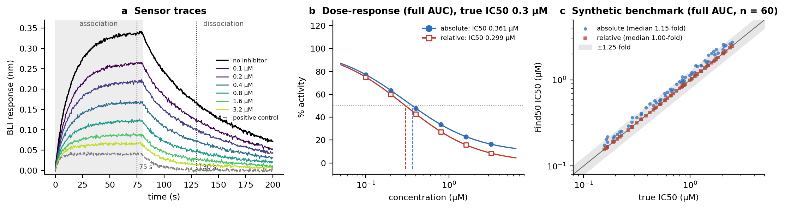

<div align="center">

# Find50

**IC50 values from concentration–response data and Octet biolayer interferometry (BLI) exports**

[](https://github.com/ack41704/Find50.py/actions/workflows/tests.yml)

[](LICENSE)

</div>



The half-maximal inhibitory concentration (IC50) is a central measurement for
drug-like compounds. Find50 turns a raw Octet BLI export into IC50 values in one
command, for inhibitors that block an analyte from binding a sensor. It does this by:

- reading every sensor trace and its Sample ID;
- assigning wells to compound dilution series, no-inhibitor references and the positive control;
- reducing each trace to four binding readouts;
- fitting a four-parameter logistic (4PL) curve to each series.

Every compound gets **eight IC50s**: association, dissociation, full-trace AUC and
association-phase AUC, each normalised in **absolute** and **relative** terms. The QC
plots let you check each one. A separate command fits any single
(concentration, response) series, so the method is not tied to BLI.

- **Reads the plate itself.** The doses, compound names, association time and controls come from the Sample IDs. You don't edit row numbers, column strides or concentration lists.
- **Defensible IC50s.**
  - A 4PL fit with a free Hill slope gives the IC50 as the concentration where the fitted curve crosses 50 % (the absolute IC50). It also reports the curve's inflection point, R² and a 95 % CI.
  - A model-free interpolated crossing is also reported. That was the original notebook's definition.
  - Results outside the tested range are reported as `< c_min` / `> c_max`, never as a made-up number.
- **Traceable.** One Excel workbook holds the IC50 summary, every dose-response point, the role assigned to every well, and the settings. It comes with a PDF of raw traces and fitted curves for each compound.
- **Checked.** The tests reproduce the IC50s and R² printed by the original notebook. On simulated plates with known IC50s, relative IC50s come back within 1.12-fold (median 1.00–1.03-fold).

---

## Contents
[Installation](#installation) · [Quick start](#quick-start) · [Input](#input-octet-export-and-sample-ids) ·
[Method](#method) · [Options](#options) · [Outputs](#outputs) · [Validation](#validation) ·
[Changes from the original notebook](#changes-from-the-original-notebook) · [Methods text](#suggested-methods-text) ·
[Citation](#citation)

## Installation

You need Python 3.9 or newer.

```bash
git clone https://github.com/ack41704/Find50.py.git
cd Find50.py
pip install -e .            # add ".[test]" to run the tests
```

The dependencies are NumPy, SciPy, pandas, openpyxl and matplotlib.

## Quick start

**1. Try it on a simulated plate.** It has four compounds with true IC50s of 0.3, 1, 12
and 0.02 µM; the doses run from 0.1 to 3.2 µM:

```bash
find50 demo --out find50_demo
```
```
IC50 (uM)                          Cmpd-1   Cmpd-2   Cmpd-3   Cmpd-4
Association at 75 s                 0.405     1.26    > 3.2    < 0.1
Relative association at 75 s        0.312    0.976    > 3.2    < 0.1
Dissociation at 130 s               0.304    0.994    > 3.2    < 0.1
...
Relative full AUC                     0.3    0.997    > 3.2    < 0.1
```

**2. Analyse an Octet export:**

```bash
find50 octet my_plate.xlsx --control "A20-I@2"
```

Pass `--control` the name and concentration (µM) of the maximal-inhibition control.
It enables the relative IC50s. Without it, only absolute IC50s are computed. Results go
to `my_plate_find50/`, and the summary table is printed.

**3. One curve from the command line** (any assay):

```bash
find50 curve --conc 0.1 0.3 1 3 10 30 --response 98 90 70 40 15 5 --top 100 --plot fit.png
```

`--top` is the no-inhibitor response (100 %). Without it, responses are normalised to
their maximum, as in the original notebook. Use `--percent` if the values are already
% activity.

**From Python:**

```python
from find50 import analyze_file, ic50

an = analyze_file("2023.71.xlsx", control="A20-I@2")
an.summary()            # wide table: readouts x compounds
an.results              # one row per compound x readout x normalisation
an.points               # every normalised dose-response point

res = ic50([0.1, 0.3, 1, 3, 10, 30], [98, 90, 70, 40, 15, 5])
res.ic50, res.label, res.hill, res.r2, res.flags
```

## Input: Octet export and Sample IDs

**File layout.** Find50 reads the Octet Data Analysis export (`.xlsx` or `.csv`). Each
well has a pair of columns, time (X) then response (Y). Above the data, the X column
holds `Sample Loc: <well>` and the Y column holds `Sample ID: <text>`. Every numeric row
below them is part of the trace. Times are measured from the first point of each trace.

**Sample IDs** carry the experiment:

```
hEphB2-His (80 sec) + 0.1 uM A20-I.2xHCl in PBSTD
└───┬────┘ └──┬───┘   └──┬─┘ └────┬────┘    └─┬─┘
 analyte  association  dose   compound     vehicle
```

- `(<n> sec)`: association length in seconds. It sets the default readout times; override it with `--association-s`.
- `+ <dose> <unit> <compound>`: the inhibitor. The unit can be pM, nM, µM/uM, mM or M.
- A Sample ID with no `+ dose compound` is a **no-inhibitor reference** (100 %).
- Sample IDs that start with *Association*, *Buffer*, *Blank* or *Baseline* are **buffer wells** and are ignored.

**Plate layout.** Each (analyte, compound) pair is one dilution series. Reference and
control wells are taken from the **same plate column** when that column has them. This
matches the usual layout of one compound per column, with the reference and positive
control in that column. Otherwise they are pooled over the file
(`--reference-scope file` forces pooling). Repeated series of the same compound in
different columns are fitted as separate replicates.

## Method

**1. Readouts.** Each trace becomes one number, using the true time axis. The defaults
for an association time *t*<sub>a</sub> follow the original analysis (75 s, 130 s, 0–80 s
for *t*<sub>a</sub> = 80 s):

| readout | definition |
|---|---|
| association | response at *t*<sub>a</sub> − 5 s (linear interpolation) |
| dissociation | response at *t*<sub>a</sub> + 50 s |
| full AUC | trapezoidal area under the whole trace |
| association AUC | area from 0 to *t*<sub>a</sub> |

**2. Normalisation.** Let *r*<sub>ref</sub> and *r*<sub>ctrl</sub> be the means of the
reference and positive-control wells (same analyte, same plate column). Then:

$$\text{absolute: } A = 100\,\frac{r}{r_\mathrm{ref}} \qquad\qquad \text{relative: } A = 100\,\frac{r - r_\mathrm{ctrl}}{r_\mathrm{ref} - r_\mathrm{ctrl}}$$

The relative scale removes signal the inhibitor cannot block, such as non-specific
binding or buffer shifts. The absolute scale keeps it.

**3. Curve fit.** % activity is fitted against *x* = log<sub>10</sub>(*c*) with a
four-parameter logistic, using bounded least squares (`scipy.optimize.curve_fit`):

$$A(x) = A_\mathrm{bottom} + \frac{A_\mathrm{top} - A_\mathrm{bottom}}{1 + 10^{\,h\,(x - \log_{10}\mathrm{EC_{50}})}}$$

The bounds are 0 ≤ *A*<sub>top</sub> ≤ 200, −50 ≤ *A*<sub>bottom</sub> ≤ 100,
0.1 ≤ *h* ≤ 10, and log EC<sub>50</sub> within 2 log units of the tested range. The
**absolute IC50** is where the fitted curve crosses 50 % activity:

$$\log_{10}\mathrm{IC_{50}} = \log_{10}\mathrm{EC_{50}} + \frac{1}{h}\log_{10}\frac{A_\mathrm{top}-50}{50-A_\mathrm{bottom}}$$

It equals the inflection point EC<sub>50</sub> (reported as `ec50_fit`) only when the
curve runs from 100 % to 0 %. The 95 % CI of the inflection comes from the fit
covariance.

**4. Reported value.** Rules are applied in this order:

1. If every dose is already ≤ 50 %, the result is `< c_min`.
2. If no dose reaches 50 %, the result is `> c_max`. The extrapolated 4PL value is still
   reported in `ic50_fit`.
3. If there are ≥ 5 doses, R² ≥ 0.8 (`--r2-min`) and the crossing is inside the tested
   range, the result is the 4PL absolute IC50.
4. Otherwise the result is the interpolated crossing. That is the lowest concentration
   at which the points, linearly interpolated in log concentration, reach 50 %. It is
   flagged.

Curves where activity rises by more than 10 points between doses are flagged as
non-monotonic. Points are never dropped automatically; remove a bad well with
`--exclude C5`.

## Options

| option | default | meaning |
|---|---|---|
| `--control NAME@CONC` | none | maximal-inhibition control, e.g. `A20-I@2` (µM; `@500nM` also works). The name matches as a prefix, so `A20-I` matches `A20-I.2xHCl` |
| `--association-s` | from Sample IDs | association length (s) |
| `--assoc-time`, `--dissoc-time` | *t*<sub>a</sub> − 5, *t*<sub>a</sub> + 50 | readout times (s) |
| `--exclude` | – | well locations to leave out, e.g. `C5 H7` |
| `--reference-scope` | `column` | `column` or `file` (see [Input](#input-octet-export-and-sample-ids)) |
| `--r2-min` | 0.8 | minimum R² for the 4PL value |
| `--sheet` | 0 | Excel sheet |
| `--out` | `<file>_find50/` | output folder |
| `--no-plots` | off | skip the PDF |

## Outputs

| file | content |
|---|---|
| `<name>_results.xlsx` | **IC50 summary**: readouts × compounds, in the layout of the original output. **IC50 details**: every IC50 with the 4PL parameters, R², CI, interpolated value, method and flags. **Dose-response**: every normalised point with its reference and control values. **Wells**: parsed Sample ID, role and readouts for every well. **Settings** |
| `<name>_ic50.csv`, `<name>_dose_response.csv` | the details and dose-response tables |
| `<name>_curves.pdf` | one page per compound: raw traces (coloured by dose, reference black, control dashed) and a dose-response panel per readout (absolute ●, relative □) |

## Validation

**Equivalence with the original notebook** (`tests/test_legacy_equivalence.py`). A
line-by-line port of the notebook's `GetData`, `FittingMath` and `Grapher` reproduces
the IC50s and R² it printed for the recorded compounds, to machine precision. On the
same points:

- Find50's interpolated crossing is the exact value that the notebook's step search approximated. It lies at most one search step (0.01 log units) below the notebook's value.
- Its Hill-1 fit gives the same R² (within 0.002).

**Synthetic benchmark** (`python examples/benchmark_synthetic.py`). The benchmark uses
60 simulated compounds. Their true IC50s are spread over 0.15–2.5 µM, with Hill slopes of
0.7–1.8, six 2-fold doses from 0.1 to 3.2 µM, noise, and a non-specific signal that the
inhibitor cannot block (`find50.synthetic`):

| readout | normalisation | median fold error | max fold error | within 1.25-fold |
|---|---|:-:|:-:|:-:|
| association | relative | 1.016 | 1.073 | 100 % |
| dissociation | relative | 1.025 | 1.115 | 100 % |
| full AUC | relative | 1.001 | 1.013 | 100 % |
| association AUC | relative | 1.002 | 1.014 | 100 % |
| association | absolute | 1.238 | 1.494 | 53 % |
| dissociation | absolute | 1.024 | 1.104 | 100 % |
| full AUC | absolute | 1.152 | 1.309 | 82 % |
| association AUC | absolute | 1.277 | 1.586 | 43 % |

Relative IC50s recover the true value. Absolute IC50s are shifted to higher
concentrations by the unblockable signal. In the simulation that signal decays quickly
during dissociation, which is why the absolute dissociation readout is barely affected.
That is why both values are reported. Synthetic data checks the implementation, not
the assay. To regenerate the figure and tables, run `python docs/make_figures.py`.

## Changes from the original notebook

The original notebook is kept in [`legacy/`](legacy/), with its outputs cleared, for
exact reproduction of earlier results.

| | original notebook | Find50 1.0 |
|---|---|---|
| plate layout | hard-coded file name, data rows 154 / 264, 16-column stride, 8 compounds | read from Sample IDs; any number of wells and compounds |
| concentrations | fixed list (0.1–3.2 µM), with the no-inhibitor well placed at 0.01 µM | parsed from the Sample IDs; the no-inhibitor well defines 100 % and is not a dose |
| normalisation | to the largest value in the series | to the reference wells (absolute) or reference and control (relative) |
| relative baseline | the smaller of control and top dose; the dissociation branch used the association value and set the top dose to 0 | mean positive control of the same plate column |
| IC50 | interpolated crossing found in 0.01-log steps (0.04 above ~2.5 µM); the fitted curve was used only for R² | exact interpolated crossing, plus the 4PL absolute IC50 with a free Hill slope, CI and decision rules |
| rising points | removed by fixed-index rules, sometimes removing the neighbouring point | kept and flagged; exclude wells explicitly |
| out of range | `>>3.2` (all > 50 %); `0.01` printed when the first dose was already < 50 % | `> c_max` / `< c_min` |
| outputs | printed values and plots | Excel workbook, CSV, PDF |

## Suggested methods text

> IC50 values were determined with Find50 v1.0.0 (Khambete, https://github.com/ack41704/Find50.py)
> from biolayer interferometry traces (Octet). For each sensor, binding was quantified as
> [the response 5 s before the end of association / the area under the full trace]. Responses
> were expressed as % activity relative to the mean of the no-inhibitor wells, after subtraction
> of the mean positive-control response ([control], [conc] µM) in the same plate column.
> % activity was fitted against log10 concentration with a four-parameter logistic model with a
> free Hill slope (bounded least squares, SciPy). The IC50 was the concentration at which the
> fitted curve crossed 50 % activity. Curves with R² < 0.8 or fewer than five doses were reported
> as the interpolated 50 % crossing. Compounds that did not reach 50 % inhibition at the highest
> concentration were reported as IC50 > [c_max].

## Repository layout

```
src/find50/
  curve.py       4PL model and fit, absolute / relative IC50, interpolated crossing, decision rules
  octet.py       Octet export reader, Sample ID parser, readouts (point, AUC)
  analysis.py    well roles, plate-column references, normalisation, per-curve IC50 table
  report.py      Excel / CSV / PDF output
  plotting.py    trace and dose-response figures
  synthetic.py   simulated Octet plates with known IC50s
  cli.py         `find50` command
tests/           pytest suite, including equivalence with the original notebook
examples/        synthetic benchmark
docs/            figure script, figures, benchmark tables
legacy/          the original notebook (outputs cleared)
```

## Citation

If you use Find50, please cite our paper:

> Wang, H., Khambete, A., Sprouse, F., Karsi, M., Cortez, K., Bellinghausen, E., Khuu, T., Block, N., Talebian, A., Ahmed, M. S., Gedara, C. M. U., Ortiz, M., & Henkemeyer, M. (2025). Eph-Ephrin Tetramerization Inhibitors Target Bidirectional Signaling to Combat Pain and Addiction. *bioRxiv*. https://doi.org/10.64898/2025.12.08.692997

```bibtex
@article{wang2025eph,
  title   = {Eph-Ephrin Tetramerization Inhibitors Target Bidirectional Signaling to Combat Pain and Addiction},
  author  = {Wang, Hanghang and Khambete, Amav and Sprouse, Frances and Karsi, Melody and Cortez, Karina and Bellinghausen, Eric and Khuu, Tamdan and Block, Natalie and Talebian, Asghar and Ahmed, Mahmoud Salama and Gedara, Chinthaka Mahesh Udamulle and Ortiz, Michael and Henkemeyer, Mark},
  journal = {bioRxiv},
  year    = {2025},
  doi     = {10.64898/2025.12.08.692997},
  url     = {https://www.biorxiv.org/content/10.64898/2025.12.08.692997v2}
}
```

GitHub's **Cite this repository** button gives the same reference (from [`CITATION.cff`](CITATION.cff)), which also records the software version.

## License

[MIT](LICENSE) © Amav Khambete
